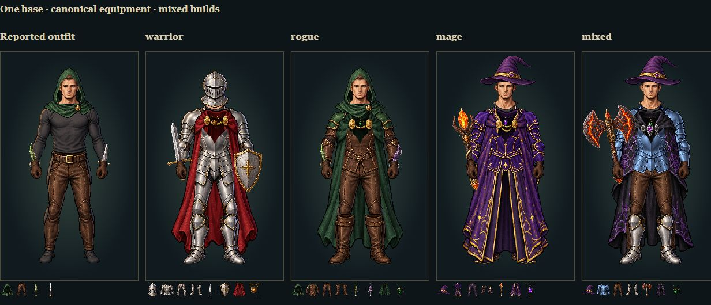
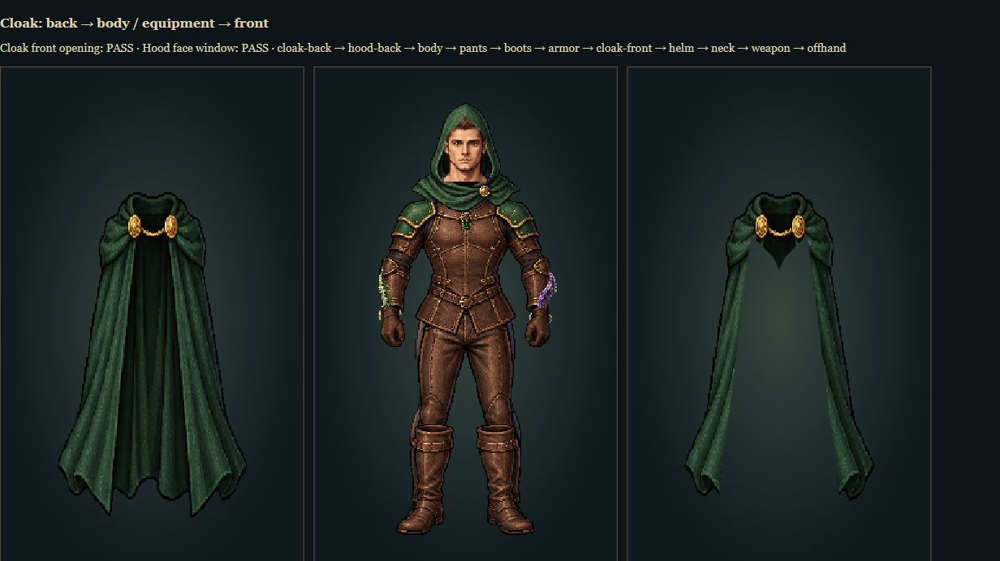
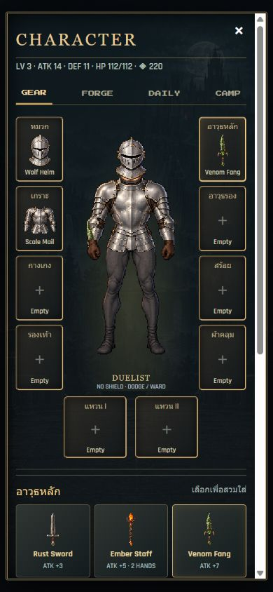

# Modular inventory repair

The previous portrait combined strips from different fully dressed characters. This version replaces that process with one frontal base body and separate clothing assets. All 47 items map to canonical artwork; icons, worn garments and the 20 held combat items share those sources.

The cloak is composited as **back cloth → body and equipment → collar/front panels**. Its authored opening preserves the torso and hanging clasp. The hood has separate backing and an open face mask. Underclothes are occluded beneath armor, boots can be removed independently, and gloves cover held shafts. Garments rasterize onto one logical pixel grid before composition, avoiding resampling changes when switching outfits.

Verification: 29 passing Node tests, including six-floor gameplay, save/equipment rules, source ownership, cloak openings and ice/ember combat materials. The browser rendered all 62 equipment/empty-slot options (47 unique items, with rings available in both slots) without errors or failed front-opening checks. Visual inspection covered the reported outfit, warrior, rogue, mage and mixed builds. Hood-face and cloak-opening pixel checks passed. Actual inventory layouts were checked at 390×844 and 320×667 with no document overflow; live combat rendered the same new weapon art and a real parry displayed `OPEN · STRIKE!`.

Physical-phone touch/performance and standalone Playwright harnesses were not tested in this session. The renderer remains a fixed inventory pose; this change does not add a full-body combat animation rig.

Run `node server.mjs --studio` and open `/tools/art-review.html` for the gallery, individual equipment controls and isolated cloak layers. It does not write the saved game.

