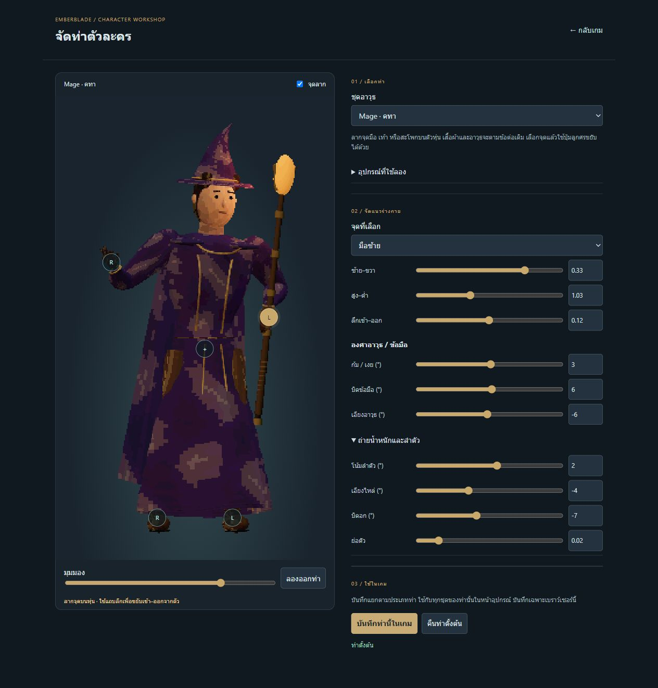
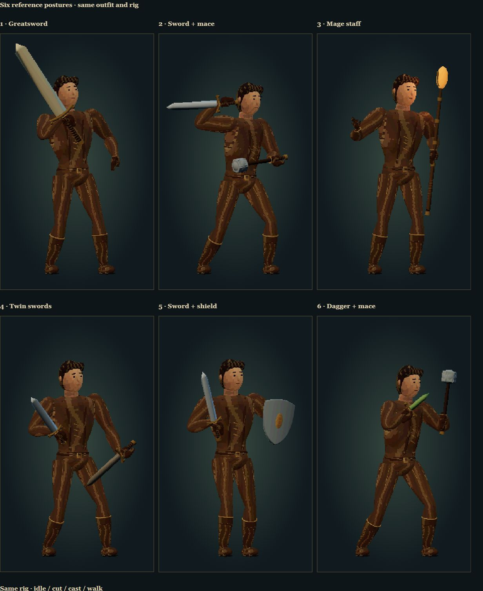

# Editable inventory postures

Open **Character → จัดท่า**, or `/tools/pose-studio.html`.

The workshop edits the same skeleton and equipment renderer used by the inventory. Drag either palm, either foot or the pelvis; arrow keys also move the selected handle. Depth, elbow bend direction, wrist/weapon angles in degrees, chest twist, shoulder tilt and crouch are adjustable. Preview the cut and try existing garments without purchasing or changing equipped items.

**บันทึกท่านี้ในเกม** saves the selected weapon-family posture in this browser under `emberblade-poses-v1`. It is separate from the progression save. Return to the game and open the inventory to load it. **คืนท่าตั้งต้น** removes only that family's saved override. Unsaved drafts remain while switching families within the workshop, but do not survive closing it.

Default poses now include body lean and lateral weight shift. Staff heads point up with a readable free casting hand; the greatsword rests above the shoulder; twin swords use different high/low lines; shield posture protects the torso. The same boot skinning, planted feet and palm attachment remain. These are inventory ready poses; first-person combat animations are unchanged.

## Checks

- 42 Node tests pass, including save isolation/validation/reset, custom pose application, arm-path continuity, greatsword support-hand contact, boot alignment and six-floor gameplay.
- 136 browser renders and 47 icons pass sampled skinning/framing checks.
- Actual pointer dragging moved a palm and a foot; keyboard input moved the pelvis. Numeric wrist rotation, outfit switching and cut preview were exercised.
- Saved a modified single-weapon pose, reloaded the workshop and recovered the edited height/angle. Returned through the real game navigation and visually verified the raised weapon. Reset the test override afterwards; progression and equipment were preserved.
- Inspected the editor at desktop size, 390×844 and 320×667; no horizontal overflow. Physical-phone touch/performance is not verified.

The editor constrains limb length and numeric ranges; it is not a collision solver. Extreme custom poses can still make garments or weapons intersect or leave the preview frame. The warning reports unreachable palm targets. Saving is local to the current browser/origin, not account-synchronized.

