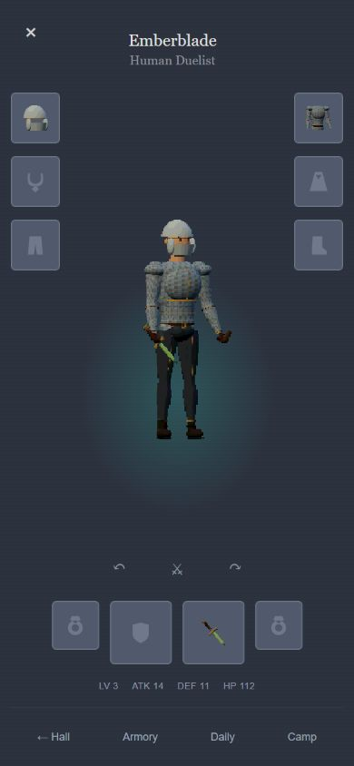
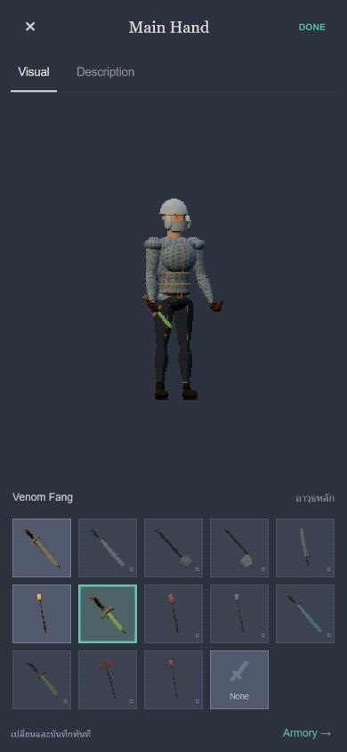
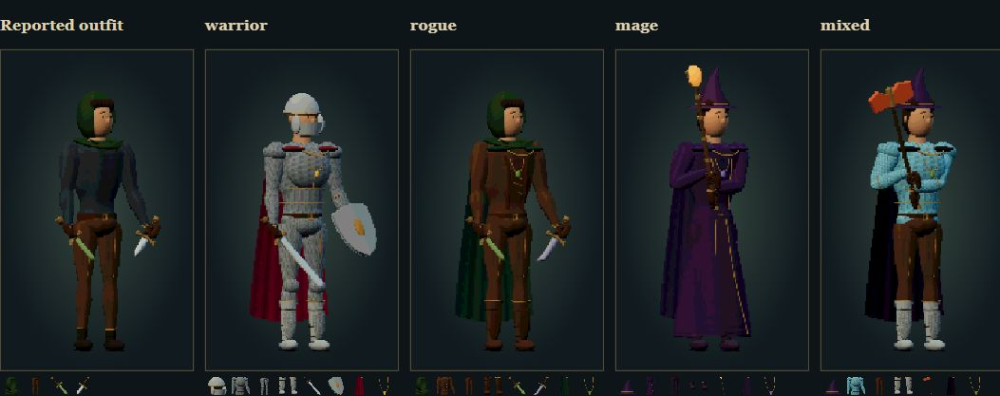

# Equipment reference repair — 2026-10-20

Reference: the user's 39.27-second `814176317.637102.mp4` (Reroll equipment demonstration).

The overview uses a blue-grey background, a three-quarter pixel character, six side slots and four lower slots. Selecting a slot opens Visual / Description, a persistent character preview, and five columns of compatible equipment. Changes apply immediately; DONE returns to the overview. Unowned items remain locked. All ten existing slots, 47 item identities, prices, stats and saves are preserved.

## Dressing, not independent pictures

- `equipment-rig.mjs` builds garments on the same body coordinates, skeleton and posture. Covered base meshes are replaced. Sleeves and trousers deform with their limbs; the hood has a physical face opening; metal helmets hide covered hair.
- The inventory no longer stretches generated full-garment or face illustrations over meshes. Clothing uses a common matte palette and small authored weave patterns. The face has physical features. All poses render onto a 144×240 pixel grid with a common shade interval.
- A cape has back cloth and front shoulder cloth/clasp. The necklace moves forward over a breastplate. Cloth, plate, trousers and footwear can be mixed without fitting unrelated source pictures by eye.
- Weapons come from the existing geometry builders, attach to the palm sockets, and hang outward in the resting pose. Two-handed equipment uses the existing shared grip IK.
- All 47 thumbnails render the actual worn geometry, including its attachments. A thumbnail is not a separately generated interpretation of the item.
- Existing combat artwork and first-person combat rendering are unchanged.

## Verification

- `npm test`: **38 passed**, including real UI event flow, persistence, the six-floor gameplay simulation, shared skinning, grip alignment, two-hand IK and front/back accessory placement.
- Browser fit checker: **47 items × idle / slash = 94 GPU renders**, all visible, finite and unclipped; all 47 fitted icons generated.
- Inspected the reported outfit, warrior, dual rogue, mage and a mixed build. Checked Visual / Description / DONE, real staff equip and offhand locking, then restored the original equipped weapon without changing gold or progress.
- Real UI checked at **404×720**, **390×844**, and **320×667**. Five columns fit without horizontal overflow. No browser errors or warnings in the checked views.
- Physical phone touch/performance and the standalone Playwright harness were not tested. The screenshots document the actual new artwork; automated fit checks do not establish subjective art quality or pixel-for-pixel identity with the reference.

