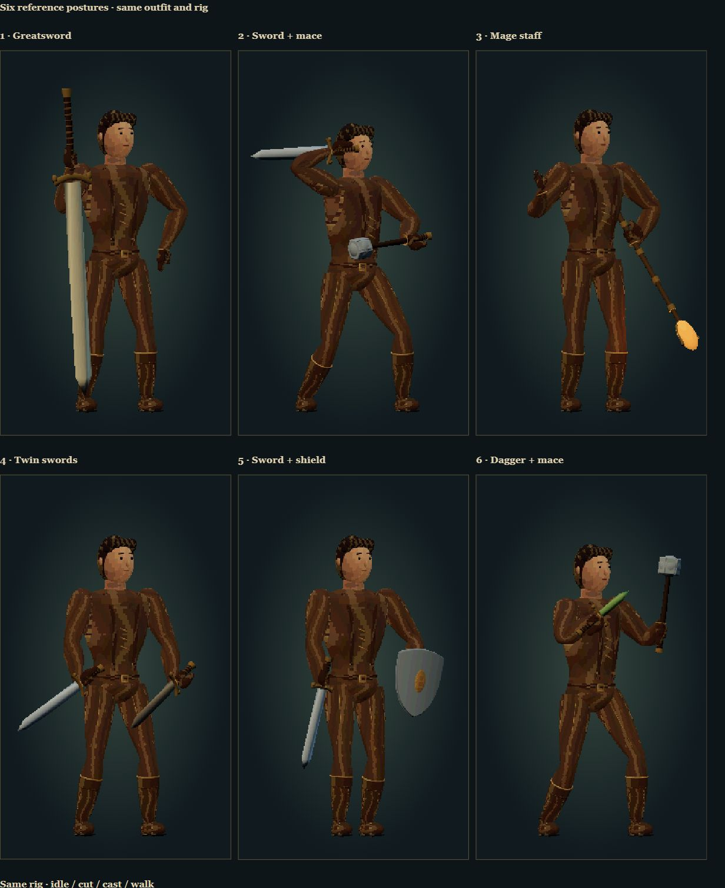
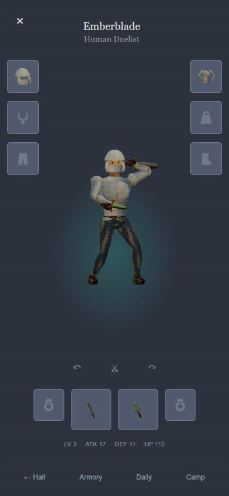

# Six reference postures and boot alignment

The inventory rig selects these silhouettes from the equipped weapon pair:

1. Greatsword: raised grip with the blade resting point-down; the second hand joins the hilt during the preview cut.
2. Sword + another one-hand weapon: sword over the shoulder, other weapon across the waist. Swapping hands mirrors the pose.
3. Staff: left-hand diagonal staff, right-hand open casting gesture.
4. Two swords: both blades low, grounded stance.
5. Weapon + shield: weapon down, shield near the hip.
6. Two short weapons: asymmetric raised guard and staggered feet.

One-hand weapons now fit either hand in the actual picker, equipment validation and save loader. Ownership, two-hand locks and shield-only blocking are preserved. Existing item unlocks have no copy counts; equipping the same unlocked one-hand type in both hands is allowed.

The reported boots were rigidly attached to the ankle, so the whole shaft stayed vertical while the calf tilted. Boot uppers now blend shin/ankle skin weights; cuffs and shin plates follow the shin, while the sole follows the planted foot. This applies to all boot variants and the base footwear.

The existing surface-bound pixel materials and shared garment skeleton remain in use. These changes affect the inventory character; the first-person combat rig is retained.

## Verification

- 41 Node tests pass, including six-floor gameplay, equipment/save compatibility, reference blade direction, both-handed greatsword contact during the cut, sampled hand-path continuity and cuff-to-shin alignment.
- Browser review: 136 renders covering all 47 items at idle/cut plus all six reference combinations and mirrored sword placement at idle and five cut/recovery times; 47 fitted icons; no invalid skinning or clipped silhouette in these samples.
- Visually inspected the six same-outfit silhouettes, boots, and mixed armor with the sword in the offhand.
- Real equipment picker: equipped Rust Sword in the offhand beside Venom Fang, confirmed persistence after reload, exercised the cut button, then restored the original empty offhand.
- Portrait layouts inspected at 390×844 and 320×667. No horizontal overflow at 320px.
- Physical-phone performance and touch remain unverified. These checks establish behavior and sampled geometry, not pixel-for-pixel resemblance to the reference illustrations.

