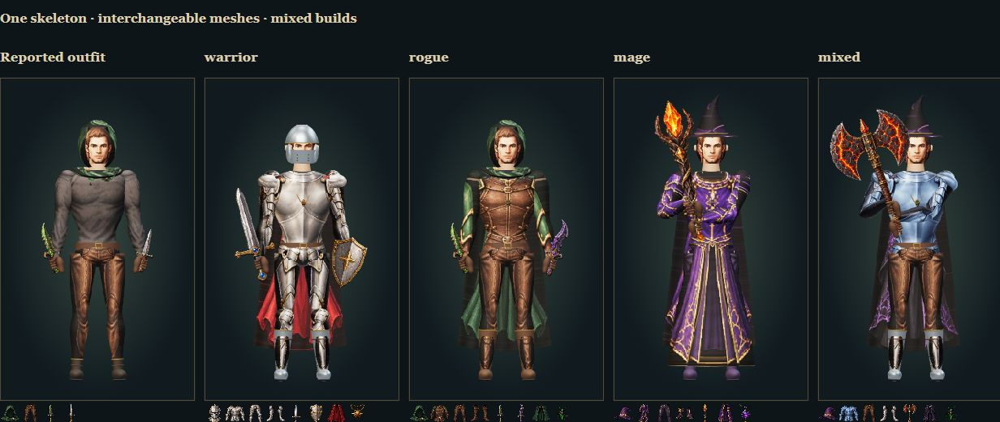
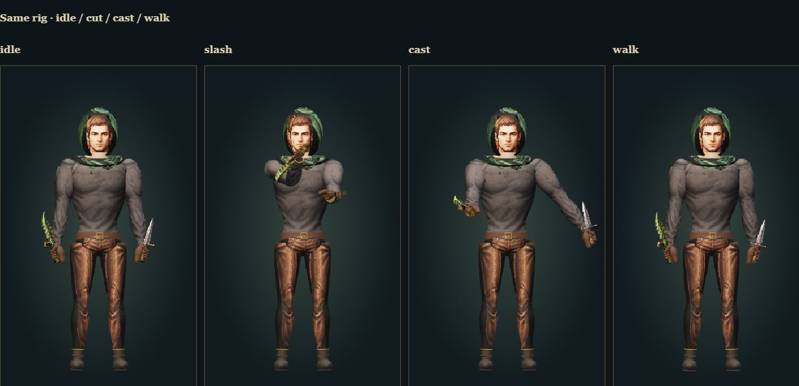
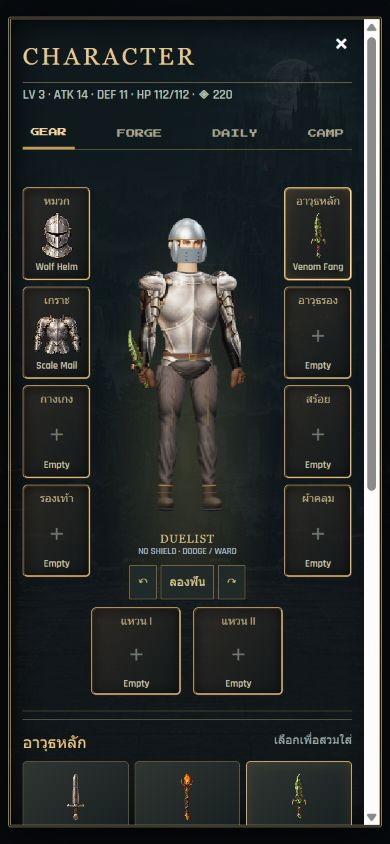

# Rigged equipment, replacing the static inventory compositor

The reported grey trouser edges and weapons behind the wrist came from a static compositor that retained the dressed base and covered handles with whole glove pictures. The active inventory now uses a 22-bone Three.js character, rendered with an orthographic camera into the existing Phaser UI. `player-portrait.mjs` is historical source, not the production inventory renderer.

Torso, continuous sleeves, continuous legs, robe and cape are weighted meshes on one skeleton. Rigid helmet details, boots, accessories and hands attach to named bones. Equipping replaces the slot's old mesh and covered base segments. Equipment uses the same anatomical dimensions across sets; the original illustrations supply surface textures, not complete character billboards. No new generated images or dependencies were added. The cloak has real depth behind the torso, shoulder cloth and a front clasp; the hood has a geometric face opening.

Weapons reuse the solid textured geometry and fitted handle used in combat. Closed fingers surround that handle. Two-handed equipment suppresses the offhand slot and solves both arms onto two points on the same shaft, including during the cut. The existing combat solver now accepts optional limb lengths; its original default remains unchanged. Idle breathing, cape sway, walking, casting, guarding and a smoothly eased cut use the same rig. Inventory exposes turn-left, try-cut and turn-right controls; reduced-motion disables ambient motion. Closing the inventory destroys its animated preview.

## RanOnline reference

Inspected at commit `4bd117d0d86a1c1c3217a0c94fb1d28b39a9fee8`:

- [`DxSkinChar::SetPiece`](https://github.com/Froztorr/RanOnline/blob/4bd117d0d86a1c1c3217a0c94fb1d28b39a9fee8/%5BLib%5D__Engine/Sources/DxMeshs/DxSkinChar.cpp#L43): replace the current piece by slot/type.
- [`DxSkinPiece::SetSkinMesh`](https://github.com/Froztorr/RanOnline/blob/4bd117d0d86a1c1c3217a0c94fb1d28b39a9fee8/%5BLib%5D__Engine/Sources/DxMeshs/DxSkinPieceContainer.cpp#L263): load the piece with its skeleton.
- [`DxCharPart`](https://github.com/Froztorr/RanOnline/blob/4bd117d0d86a1c1c3217a0c94fb1d28b39a9fee8/%5BLib%5D__Engine/Sources/DxMeshs/DxCharPart.cpp#L363): bind rigid equipment to the named hand/slot bone and compose its local transforms.
- [`DxCharSham`](https://github.com/Froztorr/RanOnline/blob/4bd117d0d86a1c1c3217a0c94fb1d28b39a9fee8/%5BLib%5D__RanClient/Sources/DxCharSham.cpp#L180): restore the default piece when an equipment slot is empty.

The implementation is new Three.js code. This is an application of the assembly/skinning pattern, not a port of Ran's C++ engine or a claim that new gear can fit arbitrary unregistered character meshes.

## Verification

Run `npm test` for shared-skeleton weights, slot coverage, fixed limb lengths, physical grip attachment, two-hand IK and actual vertex deformation, plus the existing gameplay regression suite. Run `node server.mjs --studio` and open `/tools/art-review.html`: **Check all equipment fits** renders all 47 items at idle and during a cut, checks finite deformations and checks for invisible/clipped silhouettes. The page also shows five mixed builds and four sampled poses without writing the saved game.

Verified in this change: 33 passing Node tests, including the real six-floor game loop; 94 browser renders (47 items at idle and mid-cut) with finite skinning and no clipped silhouettes; five mixed builds and four poses inspected; actual inventory at 390×844 and 320×667 without document overflow; turn/cut controls and three repeated preview open/close cycles; return to live combat and back to the hall without renderer errors. The standalone Playwright harness was updated but not run; browser interaction used the connected in-app browser.

Physical-phone touch/performance has not been tested. This full-body rig is used in the inventory; combat retains its existing first-person rig and enemy animation system.

