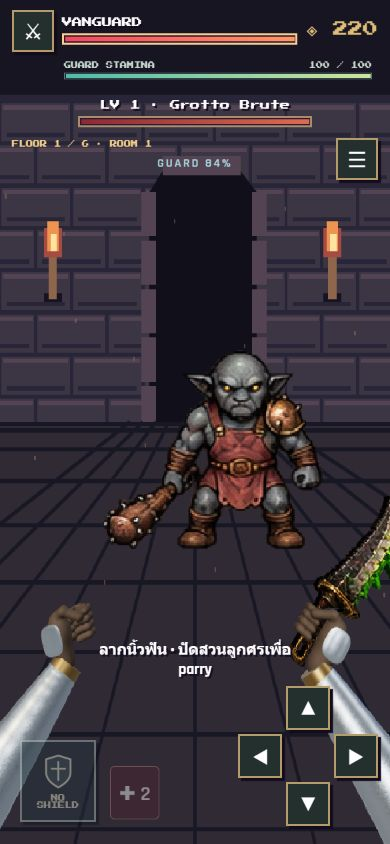
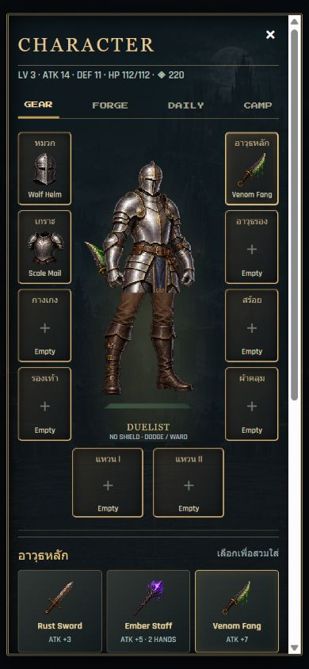
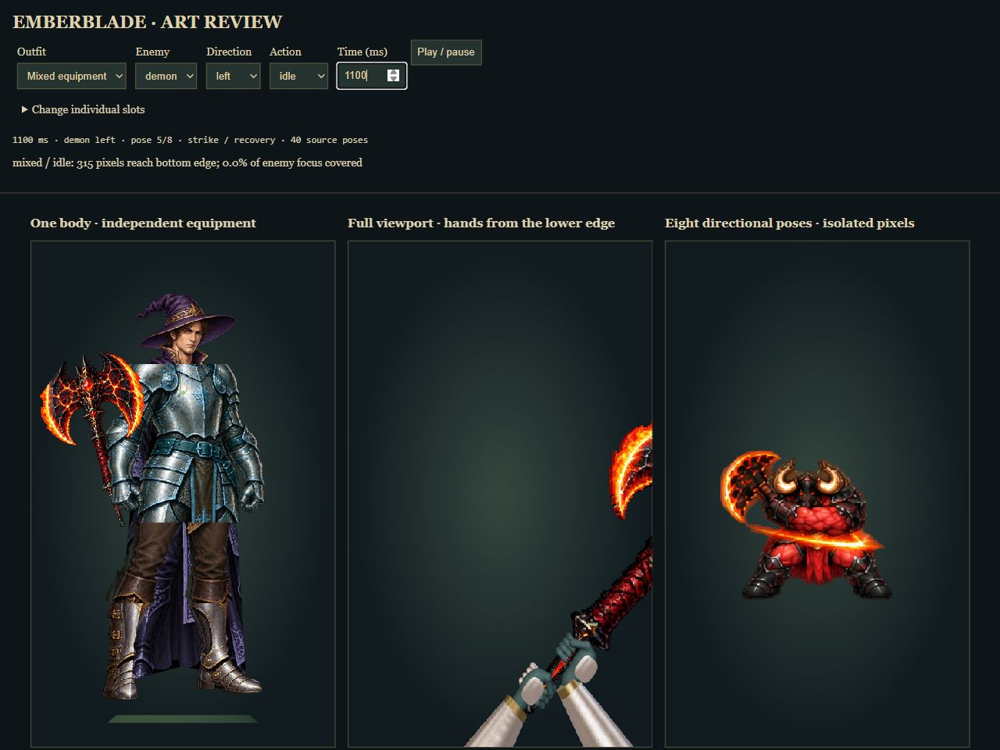

# Combat art repair

The old enemy gutters clipped neighboring art; the player framebuffer was reduced into an inner rectangle; inventory outfits were sliced from figures with different proportions. This change fixes those three rendering paths.

- Seven frontal enemy atlases: 40 source poses each, eight poses per directional attack. Pixel ownership and foot anchors prevent adjacent-frame fragments and alignment jumps. Screen-direction bindings correct reversed painted trajectories.
- Full-viewport combat arms retain their bone lengths and exit through the bottom edge. Resting grips keep the enemy clear; attacks still cross the target during contact.
- Inventory garments register to shared anatomical landmarks. Robes keep a continuous silhouette, weapons attach at the hand grip, and glove pixels occlude the shaft. Large held items are calibrated to the figure.

Verified: 26 passing Node tests, including six-floor gameplay; RGBA/nonempty-cell checks; interactive inspection of all seven atlases, warrior/rogue/mage/mixed outfits, 28 build/action combinations and 16 directional cuts. All sampled combat poses retained pixels at the bottom edge; resting poses covered 0% of the measured central enemy focus region. Live parry displayed `OPEN · STRIKE!`. Portrait layouts at 390×844 and 320×667 had no document overflow. No browser warnings/errors were reported in the inspected game path.

Physical-phone touch testing and the standalone Playwright harnesses were not run in this repair session. Browser screenshots do not establish real-device performance.

Run `node server.mjs --studio` and open `/tools/art-review.html` to inspect all poses and equipment presets without modifying a save.

