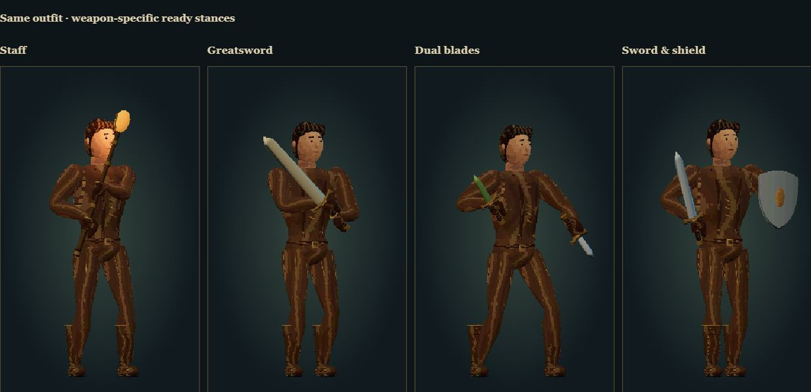
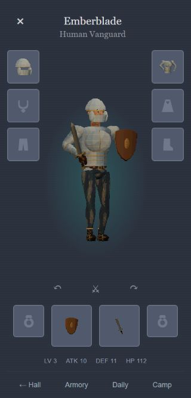

# Weapon postures and pixel surfaces

The inventory character now chooses a full-body ready stance from equipped weapons: staff, greatsword, heavy axe, dual blades, shield, wand or single weapon. The chest twist, pelvis height, planted feet, palm positions and wrist angles change together. Staff hands are separated along the shaft; greatsword hands remain together on the hilt. Cuts recover into the equipped stance.

This follows the animation-selection principle observed in Ran Online's [`DxCharSham::FrameMove`](https://github.com/Froztorr/RanOnline/blob/4bd117d0d86a1c1c3217a0c94fb1d28b39a9fee8/%5BLib%5D__RanClient/Sources/DxCharSham.cpp): guard animation selection uses `m_emANISUBTYPE`. The poses here are newly authored for the existing Three.js skeleton, not imported Ran animations.

Skin, hair, cloth, leather and metal use surface-bound pixel patterns with hue-shifted shadow/highlight palettes and five-band lighting. The inventory render grid is 240×400 rather than 144×240, avoiding the old non-integer downsample into the Phaser preview. Existing 47 items, ownership and saved equipment are retained. This is procedural pixel-styled rendering, not a hand-painted sprite replacement.

Verification: 40 Node tests pass, including weapon-dependent footing/hand targets, recovery, garment deformation and two-hand contact sampled every 25 ms through idle/cut/cast/guard. Browser checks rendered all 47 items at idle and mid-cut (94 renders), generated all 47 icons and found no invalid skinning or clipped silhouettes. Four ready stances were visually compared in the same outfit. Real inventory switching between staff, dual blades and sword/shield was checked at 390×844 and 320×667; original equipment was restored. No console errors were observed.

Physical-phone performance/touch has not been tested. These full-body poses and materials apply to the equipment preview; the first-person combat renderer is unchanged.

